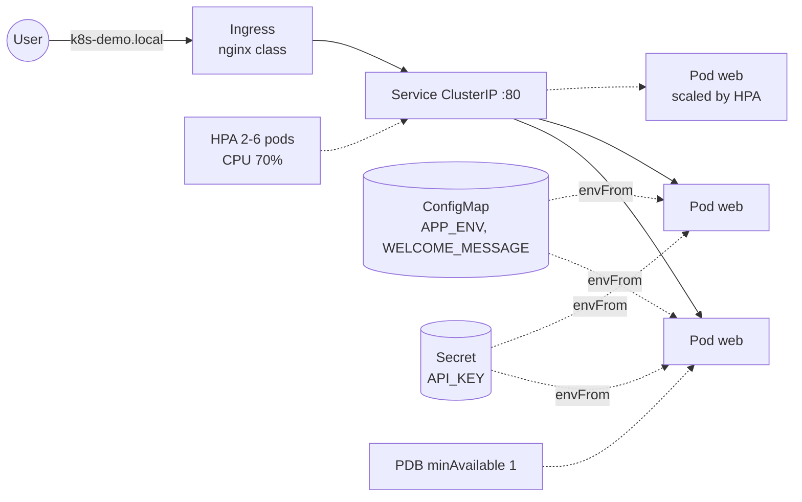

# Kubernetes Application Deployment


A small Python service deployed to Kubernetes in a production-style way:
- Kustomize base with dev and prod overlays
- ConfigMap and Secret injection
- startup, liveness and readiness probes
- resource limits and a hardened security context
- HorizontalPodAutoscaler, PodDisruptionBudget, NetworkPolicy and Ingress

Every push builds the image, spins up a real **kind** cluster in GitHub Actions, deploys the app and runs end-to-end tests. Those tests cover scaling, self-healing, a rolling update and a rollback.

> Portfolio project, made for local clusters (Minikube or kind).

## Architecture



## What's in the manifests

| Object | Purpose |
|---|---|
| `Deployment` | Rolling updates with `maxUnavailable: 0`, resource requests and limits. Runs as a non-root UID with a read-only root filesystem, drops all capabilities and uses the seccomp `RuntimeDefault` profile. |
| Probes | The **startup** probe protects slow starts. **Liveness** restarts hung containers. **Readiness** (`/readyz`) keeps pods out of the Service until warm-up finishes. |
| `ConfigMap` + `Secret` | Injected with `envFrom`. The Secret is created by Kustomize's `secretGenerator`, and its hash suffix triggers a rollout when it changes. |
| `Service` + `Ingress` | ClusterIP service behind an NGINX Ingress host rule |
| `HorizontalPodAutoscaler` | Scales between 2 and 6 pods at 70% CPU (dev: 1 to 2) |
| `PodDisruptionBudget` | Keeps at least one pod running during node drains |
| `NetworkPolicy` | Only allows TCP 8000 into the web pods |

Overlays:
- **dev:** 1 replica, local image
- **prod:** 3 replicas, a pinned GHCR image tag, `imagePullPolicy: Always` and a real hostname

## Run on Minikube

```bash
minikube start
minikube addons enable ingress metrics-server
./scripts/deploy-local.sh
./scripts/test-cluster.sh

# Optional: use the ingress
echo "$(minikube ip) k8s-demo.local" | sudo tee -a /etc/hosts
curl http://k8s-demo.local/
```

Useful commands:

```bash
kubectl -n k8s-demo get pods -w
kubectl -n k8s-demo patch hpa k8s-demo -p '{"spec":{"minReplicas":4}}'
kubectl -n k8s-demo rollout history deploy/k8s-demo
kubectl -n k8s-demo rollout undo deploy/k8s-demo
kubectl kustomize k8s/overlays/prod     # inspect rendered prod manifests
```

## CI pipeline

1. App unit tests (pytest)
2. `kubeconform -strict` against Kubernetes 1.30 schemas for both overlays
3. Create a kind cluster, build and load the image, apply the dev overlay
4. End-to-end tests (`scripts/test-cluster.sh`):
   - the service responds with ConfigMap and Secret values
   - it scales to 3 replicas
   - a deleted pod is replaced
   - a rolling update works, and a rollback restores the previous version

## Tech stack

Kubernetes · kubectl · Kustomize · Docker · kind · Minikube · kubeconform · GitHub Actions · Python/Flask

## License

MIT
